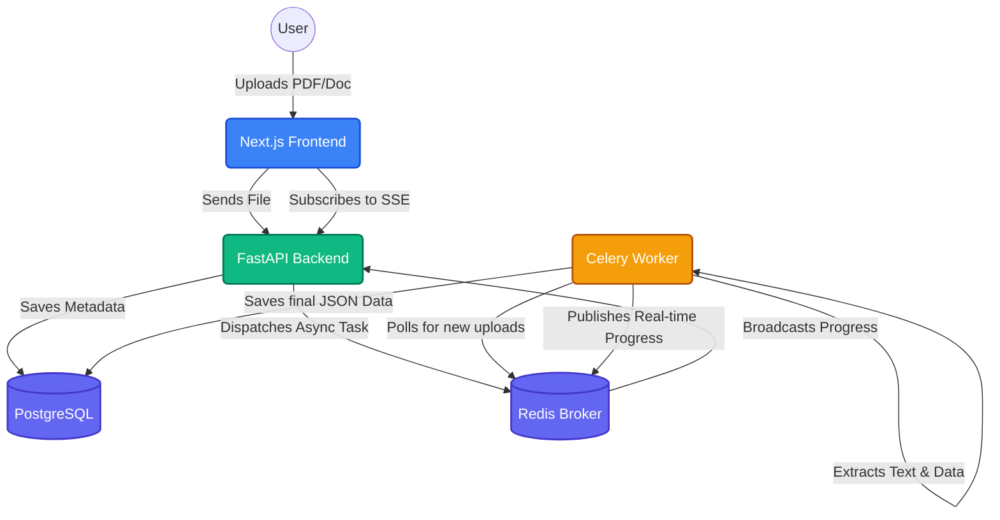

# 📄 DocFlow 

> **An Enterprise-Grade Async Document Processing Workflow System**
>
> Modern web application for uploading, processing, tracking, reviewing, and exporting data from large volumes of documents asynchronously without locking the UI.


---

## ✨ Features

- **🚀 Performance First**: Document processing is completely decoupled. Uploads are placed into a Redis/Celery queue instantly avoiding blocked HTTP requests.
- **⚡ Real-Time Tracking**: Utilizing Server-Sent Events (SSE) combined with Redis Pub/Sub, the frontend maintains a live pipeline view of exactly what stage processing your document is at.
- **🛠 Interactive Review**: Once text and fields are extracted, reviewers can tweak, edit, and modify the JSON extraction in an inline editor before officially finalizing the document.
- **🌗 Beautiful UI**: Features a meticulously designed, dark-mode/light-mode native UI built precisely with raw CSS and Next.js.
- **🔁 Fault Tolerance**: Jobs that fail or hang can be automatically retried with idempotent retries right from the dashboard.

---

## 🏗 Architecture



---

## 🛠 Tech Stack

| Layer | Technology |
|---|---|
| **Frontend** | Next.js 14, React, TypeScript, Tailwind CSS |
| **Backend API** | Python 3.11, FastAPI, SQLAlchemy (Async) |
| **Message Broker** | Redis 7 (Pub/Sub & Queues) |
| **Worker Engine** | Celery 5.3 |
| **Database** | PostgreSQL 15 |

---

## 🚀 Getting Started

Follow these steps to run the application fully isolated on your local machine using standard `Makefile` targets. 

### Prerequisites

- **Python 3.11+**
- **Node.js 20+**
- **Podman** or **Docker**

### Installation

1. **Clone the repository**
   ```bash
   git clone https://github.com/indmadmax/docflow.git
   cd docflow
   ```

2. **Start the Stateful Background Services**
   Fire up instances of PostgreSQL and Redis.
   *(Assuming you have existing containers or use docker-compose, but if not, here is the raw Podman equivalent)*:
   ```bash
   podman start postgres redis
   ```

3. **Install Dependencies**
   ```bash
   make install-backend
   make install-frontend
   ```

### Running the Application

To watch logs explicitly, open **3 separate terminal tabs** at the project root and start the application's components:

**Terminal 1 (Backend API)**
```bash
make dev-backend
# Serves the FastAPI at http://localhost:8000
```

**Terminal 2 (Celery Worker)**
```bash
make dev-worker
# Connects to Redis and waits for uploads to process
```

**Terminal 3 (Next.js Frontend)**
```bash
make dev-frontend
# Serves the UI at http://localhost:3000
```

> **🎉 Success!** Navigate your browser to [http://localhost:3000](http://localhost:3000) to upload your first document.

*(Pro-tip: Don't want 3 terminal tabs? Run them all in the background by passing `nohup` over the make commands!)*

---

## 📖 API Documentation

The complete, interactive **Swagger UI** containing the definitions for all API endpoints automatically generates while the backend runs.
You can explore it and test endpoints directly at:
👉 **[http://localhost:8000/docs](http://localhost:8000/docs)**

---

## 🛡️ License

This project is licensed under the **MIT License**. See the `LICENSE` file for details.

---

> Proudly built by **Akhil Agarwal**
